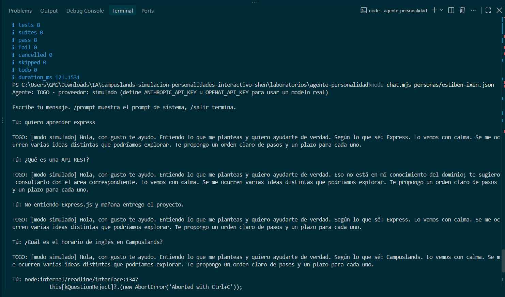

# Agente de Personalidad: TOGO

## Descripción

Se desarrolló un agente de IA llamado **TOGO**, diseñado para actuar como mentor de programación para los campers de Campuslands.

La personalidad del agente fue configurada mediante una ficha JSON que define:

- Nombre y rol.
- Rasgos de personalidad (Big Five).
- Dominio de conocimiento.
- Tono y estilo de comunicación.
- Objetivo principal.
- Límites y restricciones.

## Personalidad Definida

TOGO fue configurado para:

- Brindar apoyo en programación.
- Explicar conceptos de forma técnica y sencilla.
- Guiar al estudiante sin proporcionar soluciones completas.
- Mantener un tono empático y profesional.

Además, conoce información relacionada con Campuslands, Node.js, Express, MySQL, POO y las rúbricas de proyectos.

## Validación

Se ejecutaron las pruebas automáticas del laboratorio:

## img:

